[English](README.md) · **Español**

---

## 🦦 Sobre mí

Arquitecto de software en **LCT Global**. Dirijo agentes de IA para construir software de producción con disciplina de ingeniería, no con vibe-coding.
La arquitectura, los contratos y la verificación quedan en manos humanas; la implementación se delega y se comprueba.

- 🏗️ **Arquitectura limpia / hexagonal**: fundamentos antes que frameworks
- 🌱 **ODD (Organic Driven Development)**: mi flujo por defecto en cada cambio
- 📐 **SDD (Spec-Driven Development)**: el camino formal, solo cuando hay ambigüedad real
- 🧪 **TDD**: los tests guían, el código sigue
- 🔌 **Tooling propio**: servidores MCP, skills de Claude Code y memoria persistente para agentes

## 🧭 Cómo trabajo

**ODD** es lo normal: explorar primero, preguntar solo decisiones reales de producto, dividir el trabajo grande en tareas trazables y cerrar cada tarea con un commit revisable.
**SDD** vive *dentro* de ODD: cuando un cambio es ambiguo, se abre la rama propuesta → spec → diseño → tareas, y luego vuelve al ciclo de construcción.

  

## 🚀 Proyectos destacados

| Proyecto | Qué hace | Stack |
|---|---|---|
| 🎨 [**TattooView**](https://github.com/AroxArth/TattoView) | Editor 3D en el navegador que proyecta un diseño de tatuaje sobre un brazo real: tamaño real en cm, espejo, estirado, tono de piel, profundidad de tinta, exportación de foto y sesión. Hecho con SDD (OpenSpec). | React 19 · three.js · R3F · zustand |
| 🎧 [**copiloto-llamada**](https://github.com/AroxArth/copiloto-llamada) | Copiloto de escritorio para llamadas: captura el audio del sistema, lo transcribe en local con la GPU, detecta preguntas y muestra una respuesta de IA en un overlay flotante. | Python · faster-whisper · PySide6 |
| 🔊 [**NotiPay**](https://github.com/AroxArth/NotiPay) | Confirmación por voz, manos libres, de los pagos Yape recibidos, contra el fraude de pagos falsos. | Kotlin · Jetpack Compose · Room |
| 📝 [**meet-matic**](https://github.com/AroxArth/meet-matic) | Transcripción de reuniones en tiempo real y 100% local, exportada a Markdown para IA. | Python · faster-whisper · VAD |
| ✨ [**Portafolio**](https://github.com/AroxArth/AroxArth.github.io) | Sitio personal con animaciones guiadas por scroll e interfaz liquid-glass. | Astro · React · GSAP · Tailwind |

<b>💼 Trabajo para clientes y privado</b>

 

- **Sisges SSSR**: reescritura desde cero de un sistema legado en VB6 de salud y pensiones, con migración de datos por fases.
- **SisBáscula**: app de escritorio de pesaje de camiones conectada a una balanza física por TCP.
- **WashClaw**: SaaS multi-tenant para autolavados, hecho con SDD y tests unitarios + E2E.
- **Carlos Ayasta — Web**: sitio de un fotógrafo documental: portafolio, libros digitales, blog y crowdfunding.
- **Tarjetas NFC para mascotas**: perfiles de mascotas con sticker NFC, galería, estado de "perdido" y botón de WhatsApp/ubicación.

Más detalles en el [portafolio](https://aroxarth.github.io).

## 🛠️ Stack

  
   
  

  
  
  

