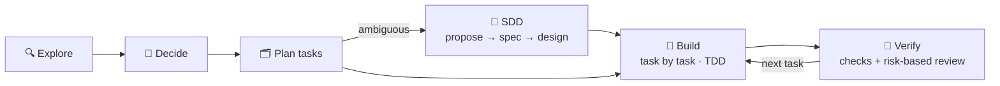

# Hi, I'm AroxArth 🦦

**AI-Driven Software Architect & Full-Stack Developer @ LCT Global** · Lima, Peru

*I design the system. The AI executes. I verify.*

---

## About

I lead AI agents to build production software with engineering discipline, not vibe-coding.
Architecture, contracts, and verification stay human; implementation is delegated and checked.

- 🏗️ **Clean / Hexagonal architecture**: foundations before frameworks
- 🌱 **ODD (Organic Driven Development)**: my default flow for every change
- 📐 **SDD (Spec-Driven Development)**: the formal path when ambiguity is real
- 🧪 **TDD**: tests lead, code follows
- 🔌 **Custom tooling**: MCP servers, Claude Code skills, and persistent agent memory

## How I work

**ODD** is the default: explore first, ask only real product questions, track substantial work as tasks, and close every task with a reviewable commit.
**SDD** is a branch inside it, opened only when a change needs a proposal, spec, and design before code.

## Featured projects

| Project | What it does | Stack |
|---|---|---|
| [**NotiPay**](https://github.com/AroxArth/NotiPay) | Hands-free voice confirmation of incoming Yape payments, against fake-payment fraud | Kotlin · Jetpack Compose · Room |
| [**meet-matic**](https://github.com/AroxArth/meet-matic) | Real-time, 100% local meeting transcription exported to Markdown for AI | Python · faster-whisper · VAD |
| [**Portfolio**](https://github.com/AroxArth/AroxArth.github.io) | Personal site with scroll-driven animations and liquid-glass UI | Astro · React · GSAP · Tailwind |

Client work (private): a legacy VB6 health & pensions system rewritten from scratch, a truck-weighing desktop app wired to a physical scale over TCP, and a multi-tenant car-wash SaaS. Details on the [portfolio](https://aroxarth.github.io).

## Stack

 

