**English** · [Español](README.es.md)

---

## 🦦 About me

Software Architect @ **LCT Global**. I lead AI agents to build production software with engineering discipline, not vibe-coding.
Architecture, contracts and verification stay human; implementation is delegated and checked.

- 🏗️ **Clean / Hexagonal architecture**: foundations before frameworks
- 🌱 **ODD (Organic Driven Development)**: my default flow for every change
- 📐 **SDD (Spec-Driven Development)**: the formal path, only when ambiguity is real
- 🧪 **TDD**: tests lead, code follows
- 🔌 **Custom tooling**: MCP servers, Claude Code skills and persistent agent memory

## 🧭 How I work

**ODD** is the default: explore first, ask only real product questions, split big work into tracked tasks, and close every task with a reviewable commit.
**SDD** lives *inside* ODD: when a change is ambiguous, it branches into proposal → spec → design → tasks, then returns to the build loop.

  

## 🚀 Featured projects

| Project | What it does | Stack |
|---|---|---|
| 🎨 [**TattooView**](https://github.com/AroxArth/TattoView) | In-browser 3D editor that projects a tattoo design onto a real arm mesh: real size in cm, mirror, stretch, skin tone, ink depth, photo and session export. Built with SDD (OpenSpec). | React 19 · three.js · R3F · zustand |
| 🎧 [**copiloto-llamada**](https://github.com/AroxArth/copiloto-llamada) | Desktop copilot for calls: captures system audio, transcribes it locally on the GPU, detects questions and streams an AI answer into a floating overlay. | Python · faster-whisper · PySide6 |
| 🔊 [**NotiPay**](https://github.com/AroxArth/NotiPay) | Hands-free voice confirmation of incoming Yape payments, against fake-payment fraud. | Kotlin · Jetpack Compose · Room |
| 📝 [**meet-matic**](https://github.com/AroxArth/meet-matic) | Real-time, 100% local meeting transcription exported to Markdown for AI. | Python · faster-whisper · VAD |
| ✨ [**Portfolio**](https://github.com/AroxArth/AroxArth.github.io) | Personal site with scroll-driven animations and liquid-glass UI. | Astro · React · GSAP · Tailwind |

<b>💼 Client & private work</b>

 

- **Sisges SSSR**: from-scratch rewrite of a legacy VB6 health & pensions system, with phased data migration.
- **SisBáscula**: desktop truck-weighing app wired to a physical scale over TCP.
- **WashClaw**: multi-tenant SaaS for car washes, built with SDD and unit + E2E tests.
- **Carlos Ayasta — Web**: site for a documentary photographer: portfolio, digital books, blog and crowdfunding.
- **Pet NFC cards**: NFC-sticker pet profiles with gallery, lost-pet status and WhatsApp/location sharing.

Details on the [portfolio](https://aroxarth.github.io).

## 🛠️ Stack

  
   
  

  
  
  

